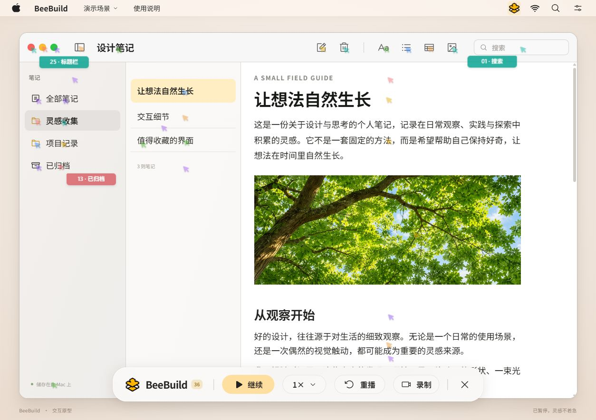

<p align="center">
  
</p>

<h1 align="center">BeeBuild</h1>

<p align="center"><strong>让熟悉的界面，重新发生。</strong></p>
<p align="center">36 个彩色光标，各自接手一小块内容，把文字、图片和控件重新画出来。</p>
<p align="center">中文交互 · 连续滚动 · 独立分工 · 本地录制</p>
<p align="center"><a href="https://github.com/JulyanXu/BeeBuild/releases/tag/v0.1.0">v0.1.0 版本说明</a> · <a href="#开始体验">操作指南</a> · <a href="#本地开发">运行原型</a></p>



BeeBuild 是一个视觉重建工具的浏览器交互原型。它把熟悉的页面变成一段可观看、可掌控的构建过程：文字逐行输入，图片慢慢显现，控件与分隔线各自成形。你可以观察不同内容的动画节奏，也可以录下一段演示，分享界面从空白到完整的过程。

## 一起开工，各有分工

- **36 个光标，独立负责内容。** 每项任务有固定负责人和局部位置锚点；文件的图标、名称、日期、类型分别施工，同一区域的重叠内容依次绘制。
- **滚动到哪里，构建到哪里。** 滚动时动画持续推进，新出现的内容加入队列，已完成的部分保留。当前视口完成后，光标继续待命。
- **不同内容，不同动作。** 打字、图片显现、控件描边与线条绘制各有节奏，工作中的光标更醒目，待命光标保持轻盈。
- **节奏由你掌控。** 底部磨砂控制条提供暂停、继续、四档速度和当前视口重播；随时可以退出。
- **把过程留在本地。** 主动选择浏览器共享画面，停止后预览并下载视频，录制文件不上传。

这里的 Agent 是由动画调度器控制的视觉光标，用来表现协作过程；项目没有运行 36 个自主 AI 模型。

## 三种熟悉的场景

| 场景 | 看什么 | 可以操作什么 |
| --- | --- | --- |
| 设计笔记 | 三栏布局、标题正文、树冠照片、收藏条目 | 切换文件夹与笔记，搜索、滚动、收藏 |
| 长网页 | 文章标题、图文内容、段落与分隔线 | 切换主题，搜索文章、收藏、继续阅读 |
| 应用列表 | 文件图标、名称、日期、类型与详情 | 切换文件位置、列表/图标视图，搜索、选择与收藏 |

## 开始体验

在菜单栏的「演示场景」中选择一个窗口，点击「重画当前窗口」，然后自由滚动。暂停一下看清某个细节，或把速度调快，让光标继续完成剩下的内容。

| 操作 | 方式 |
| --- | --- |
| 开始 / 结束重画 | `Alt + Shift + B`，或菜单中的对应操作 |
| 暂停 / 继续 | 底部「暂停」「继续」按钮 |
| 调整速度 | `0.5×`、`1×`、`2×`、`3×`；切换时保留进度 |
| 重播当前视口 | 底部「重播」；保持当前位置 |
| 录制与下载 | 点击「录制」，选择共享画面；停止后预览、下载 |
| 退出 | 底部关闭按钮；`Esc` 先关闭菜单或对话框，再退出重画 |

设置中可以更改页面内快捷键，或打开「减少光标动效」，隐藏移动光标并保留逐块呈现。快捷键需要页面聚焦，设置仅在本次预览中保留。

## 当前实现范围

重画基于三个模拟场景的页面 DOM。Mac 风格的窗口是浏览器界面，本项目尚未实现真实 Mac 应用窗口捕获或系统全局快捷键。原生实现方向见 [Mac 实现与验收清单](docs/native-mac-checklist.md)。

录制使用浏览器的共享选择器，建议选择当前 BeeBuild 标签页。它需要支持 `getDisplayMedia` 与 `MediaRecorder` 的桌面浏览器，以及 localhost 或 HTTPS 环境。视频不含声音，优先使用 WebM，按浏览器能力回退到 MP4；当前不导出 GIF。暂停重画时，录制会继续。

## 本地开发

使用 **Node.js 22**，技术栈为 React 19 + Vite 6。

```sh
git clone https://github.com/JulyanXu/BeeBuild.git
cd BeeBuild
npm ci
npm run dev -- --host 127.0.0.1 --port 4173 --strictPort
```

打开 [http://127.0.0.1:4173](http://127.0.0.1:4173)。生产构建与检查：

```sh
npm run build
npm test
npm run test:sites
```

完整测试包含构建产物检查，干净检出后请先构建再测试。仅验证播放调度可运行 `node --test tests/engine.test.js`。[GitHub Actions](.github/workflows/ci.yml) 会在 `main` 推送和拉取请求中运行生产构建及测试。

## 项目结构与维护

| 路径 | 内容 |
| --- | --- |
| [`src/App.jsx`](src/App.jsx) | 播放控制、菜单、设置与页面快捷键 |
| [`src/Scenes.jsx`](src/Scenes.jsx) | 三个可交互演示场景 |
| [`src/engine/`](src/engine/) | DOM 测量、任务分配、虚拟时钟与光标呈现 |
| [`src/recording/`](src/recording/) | 浏览器录制、预览和下载 |
| [`tests/`](tests/) | 播放调度、录制生命周期与 Sites 构建检查 |
| [`design/selected-frosted-dock.png`](design/selected-frosted-dock.png) | 选定视觉方案 |

场景通过稳定且唯一的 `data-build` 和 `data-kind="text/image/box/line"` 标记真实叶子任务，通过 `data-build-region` / `data-region-label` 标记语义区域。复合内容拆分为独立叶子，避免父子元素重复绘制；内容变化通过 `onContentChange` 通知引擎。

播放使用单一虚拟时钟，滚动只更新几何和可见任务。36 个光标保留各自的位置与任务归属，最多 24 项可见任务并行。修改引擎时需覆盖调速连续性、显式暂停、当前视口重播、离屏进度、滚动新增内容、任务唯一归属与退出清理。录制独立管理生命周期，需处理共享取消、拒绝、停止和编码失败，并释放媒体轨道与预览 URL。

**Sites 支持：** 保留 `.openai/hosting.json`、`worker/index.js`、`scripts/prepare-sites-build.mjs` 与 `tests/sites-worker.test.mjs`。交接前运行 `npm run build` 和 `npm run test:sites`，构建输出应包含 `dist/client/index.html`、`dist/server/index.js`、`dist/.openai/hosting.json`。

更多资料：[交互规格](docs/interaction-spec.md) · [浏览器验收记录](design-qa.md) · [资产来源](docs/assets.md) · [项目约定](AGENTS.md)

## 致谢

交互节奏与工具动作参考 [Swarm Rebuild](https://github.com/DhvanilPatel/swarm-cursors)，BeeBuild 的动画调度与呈现独立实现。UI 图标使用 [Phosphor](https://phosphoricons.com/)；树冠照片与透明 BeeBuild 标志由 ImageGen 生成。
